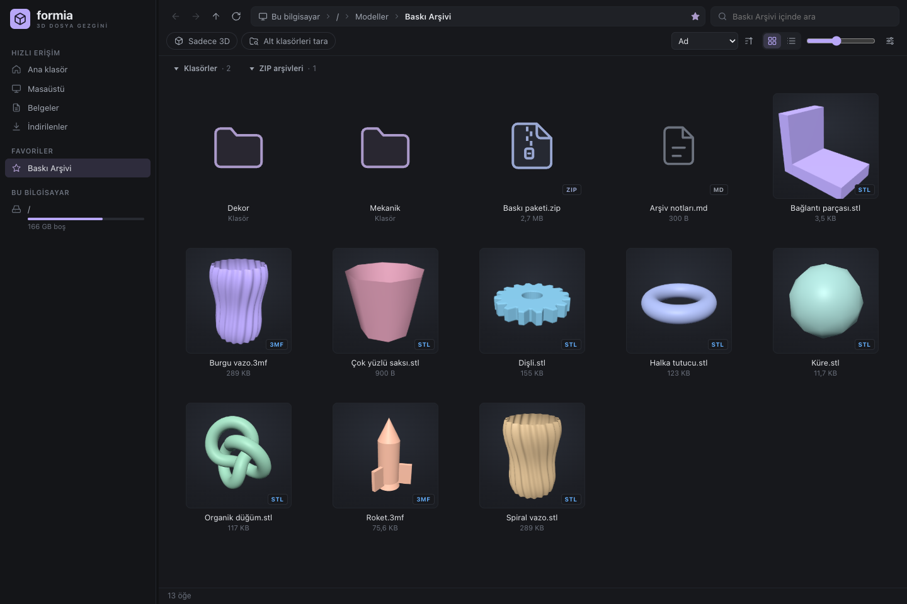
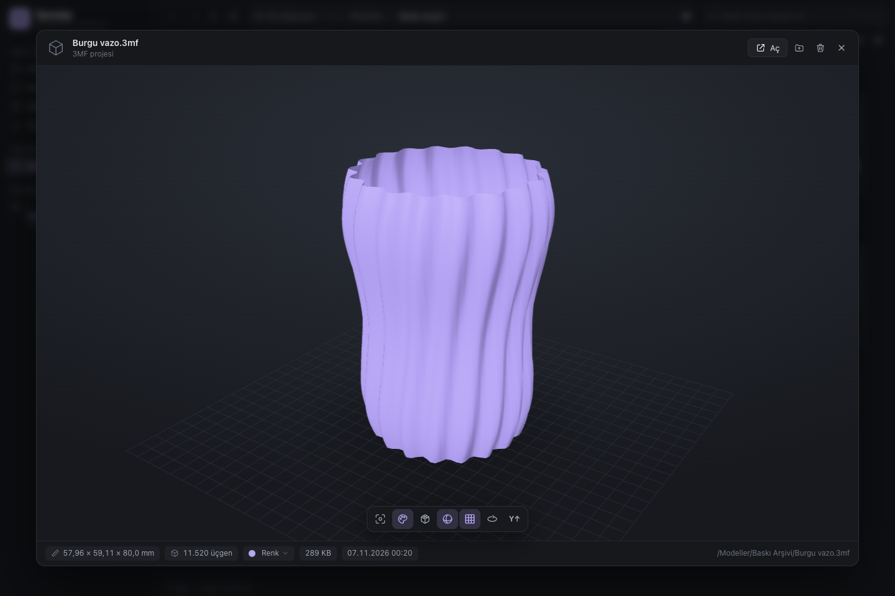
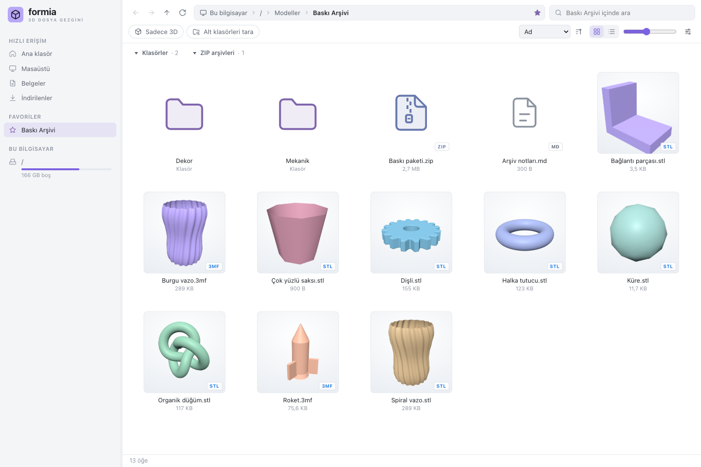
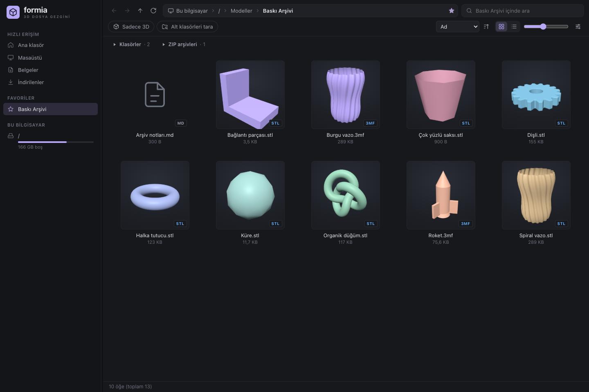

**English** | [Türkçe](README.tr.md)

<div align="center">


# Formia

### Your 3D printing archive, at a glance.

Stop getting lost in folders and ZIPs. **Find models by their thumbnails**,<br/>inspect them in 3D with **Space**, then drag them into your slicer.

[](https://github.com/sessizz/formia/releases/latest) [](https://github.com/sessizz/formia/actions/workflows/windows-release.yml) [](LICENSE)  

[**Download**](https://github.com/sessizz/formia/releases/latest) &nbsp;·&nbsp; [**Screenshots**](#screenshots) &nbsp;·&nbsp; [**Build from source**](#building-from-source) &nbsp;·&nbsp; [**Roadmap**](ROADMAP.md) &nbsp;·&nbsp; [**Report a bug**](https://github.com/sessizz/formia/issues)

<br/>



</div>

---

## Why Formia?

STLs on one drive, 3MF projects in another folder, ZIP bundles in Downloads… Formia brings a familiar file browser to your 3D printing archive. See models without opening each one in a slicer, browse inside ZIPs, and scan all models beneath a folder in one view.

**A local desktop app.** There is no need to import your archive or move your files. Tauri 2 and Rust handle file operations; three.js renders the interactive previews.

## Download and get started

| Platform | Package | How to use |
| --- | --- | --- |
| **macOS · Apple Silicon** | [Download DMG](https://github.com/sessizz/formia/releases/latest/download/Formia_1.0.0_aarch64.dmg) | Open it and drag **Formia** into **Applications**. |
| **Windows · x64** | [EXE installer](https://github.com/sessizz/formia/releases/latest/download/Formia_1.0.0_x64-setup.exe) | Run the installation wizard. |
| **Windows · x64 · Portable** | [Download standalone EXE](https://github.com/sessizz/formia/releases/latest/download/Formia_1.0.0_x64-portable.exe) | Save it to any folder and run it directly. |

Packages are currently **unsigned**; macOS Gatekeeper and Windows SmartScreen may ask for additional confirmation on first launch. Windows requires the **Microsoft Edge WebView2 Runtime**, which is not included in the portable package. The macOS package supports Apple Silicon (`arm64`) only.

After downloading:

1. Select a folder in the sidebar or paste its path into the address bar.
2. Select a model and press **Space**; rotate, pan, and zoom with the mouse.
3. Drag the file into Bambu Studio, OrcaSlicer, PrusaSlicer, or your preferred slicer.

[All releases and SHA-256 files →](https://github.com/sessizz/formia/releases)

## Features

| | |
| --- | --- |
| **🧊 3D previews with Space**<br/>Dimensions, triangle count, wireframe, smooth shading, floor grid, and auto-rotation. | **🎨 Filament colors**<br/>3MF colors from Bambu Studio, OrcaSlicer, and PrusaSlicer. Try preset PLA colors in the preview. |
| **🗃️ Browse inside ZIPs**<br/>See model thumbnails and previews without extracting the archive. | **📑 Multiple build plates**<br/>Select plates by their thumbnails and inspect each one separately in 3MF projects. |
| **🧵 Finished-print view**<br/>View G-code as ribbons using its line width and layer height. Sliced `.gcode.3mf` files are supported too. | **🔎 Search your archive**<br/>Instant search, Turkish character-insensitive matching, a “3D only” filter, and recursive folder scanning. |
| **💜 A calm workspace**<br/>Lavender folders and zippered archive icons; collapse or expand each group independently. | **⚡ Ready for large folders**<br/>Virtualized grid/list views, multithreaded thumbnail generation, and a disk cache. |

- **Favorites and drives:** quick access, drag-to-reorder favorites, USB/network drives, and storage usage bars.
- **File operations:** multiple selection, inline renaming, moving files to the Recycle Bin/Trash with confirmation, and dragging files into a slicer.
- **Dark, light, and system themes.** Color-menu changes affect only the preview; they are never written to the model file.
- **English and Turkish interface.** On first launch, Formia uses Turkish if your system's preferred language is Turkish, and English otherwise. Change it anytime in **Settings → Language**; your choice is saved and applies immediately.
- **Embedded previews:** reads 3MF plate images and G-code thumbnails. Embedded 3MF images can be disabled in settings.

## Screenshots

<table>
  <tr>
    <td width="50%"><br/><sub><b>Inspect a model with one key.</b> Press Space for a rotatable 3D view, dimensions, and filament colors.</sub></td>
    <td width="50%"><br/><sub><b>Light theme.</b> The same lavender palette in a brighter workspace.</sub></td>
  </tr>
  <tr>
    <td colspan="2"><br/><sub><b>Make room for models.</b> Collapse folders and ZIPs independently; files move up to fill the space.</sub></td>
  </tr>
</table>

<sub>Screenshots show the current Formia interface using sample data and geometric models created for this presentation. They contain no personal archive or file information.</sub>

## Supported formats

| Type | Extensions | Preview |
| --- | --- | --- |
| Print models | `stl` `3mf` `obj` `ply` `off` | Rust parser + three.js |
| Scenes | `glb` `gltf` | three.js with materials and textures |
| Other 3D formats | `fbx` `dae` `3ds` `amf` `wrl` `vrml` | three.js |
| CAD | `step` `stp` `iges` `igs` `brep` | OpenCascade / WebAssembly |
| Sliced prints | `gcode` `gco` `g` · `.gcode.3mf` | Finished-print ribbons; thin toolpath lines for large files |
| Images and documents | `png` `jpg` `webp` `gif` `bmp` `tga` · `pdf` `txt` `md` `scad` … | Image, PDF, or text |
| Video | `mp4` `webm` | Video playback |
| Archives | `zip` | Folder-like browsing, model thumbnails, and previews |

3MF previews read filament assignments, painted surfaces, and standard `basematerials` / `colorgroup` colors. If a `.gcode.3mf` contains `Metadata/plate_N.gcode`, Formia shows the sliced print; otherwise it opens the file as a regular 3D model.

## Keyboard shortcuts

| Key | Action |
| --- | --- |
| **Space** | Open / close preview |
| **← → ↑ ↓** | Move selection; switch models in the preview |
| **Enter** / double-click | Open a folder or open a file in its default application |
| **Cmd+↑ / Cmd+↓** (Mac) | Go to parent folder / open selected item |
| **Alt+↑ / Alt+↓** (Windows) | Go to parent folder / open selected item |
| **Backspace** | Go to parent folder |
| **Alt+← / Alt+→** | Back / forward |
| **Ctrl+L** / **F4** | Edit the address bar |
| **Ctrl+F** / **Ctrl+Shift+F** | Search / scan subfolders |
| **Ctrl+D** | Add / remove current folder from favorites |
| **Ctrl+1 / Ctrl+2** | Grid / list view |
| **Ctrl+wheel** / **Ctrl + / −** | Thumbnail size |
| **F2** | Rename |
| **Delete** / **Cmd+Backspace** on Mac | Move to Recycle Bin/Trash with confirmation |
| **F5** | Refresh |
| **R · C · W · S · G · A · U** | In preview: reset, colors, wireframe, smooth shading, grid, rotation, and up axis |

Most Ctrl shortcuts also work with **Cmd** on macOS. Type letters to select files by name.

## Building from source

Requirements: **Rust stable**, **Node.js**, and the build tools for your platform. Node.js is used only to run the Tauri CLI through `npx`.

```sh
git clone https://github.com/sessizz/formia.git
cd formia
```

### macOS · Apple Silicon

Install Xcode Command Line Tools (`xcode-select --install`), then run:

```sh
source ~/.cargo/env
./build-mac.sh
```

Default output paths:

```text
~/.cache/model-gezgini-target/release/bundle/macos/Formia.app
~/.cache/model-gezgini-target/release/bundle/dmg/Formia_1.0.0_aarch64.dmg
```

Override the output directory with `CARGO_TARGET_DIR`. Intel/universal packages are currently outside the supported scope.

### Windows · x64

Requires the Rust **MSVC** toolchain, the **Desktop development with C++** components from Visual Studio Build Tools, and the WebView2 Runtime. In PowerShell:

```powershell
# Launch development mode
.\dev.ps1

# Build the NSIS installer and portable formia.exe
.\build.ps1
```

The script prints the full paths to the installer and portable EXE. In development mode, reload interface changes with **Ctrl+R**.

### Tests

```sh
cd src-tauri
cargo test
```

<details>
<summary><b>Dependencies, build cache, and release workflow</b></summary>

- This is not an npm application; **neither `npm install` nor `node_modules` is required**. three.js and OpenCascade dependencies are vendored in `ui/vendor/`.
- The Tauri CLI is downloaded to the npm cache and run with `npx --yes @tauri-apps/cli@2`.
- Source code is shared between machines through Git; build outputs and dependencies are generated locally on each machine.
- On Windows, set a local Rust output directory using `[build] target-dir` in the gitignored `src-tauri/.cargo/config.toml` file.
- The [Windows release workflow](.github/workflows/windows-release.yml) is triggered manually. Given an existing **draft release** and its source commit SHA, it runs Rust tests, builds the NSIS installer and standalone portable EXE, and uploads them to the draft with SHA-256 files. It does not publish the release automatically.
- Automatic application updates and code signing are not available yet; see the [roadmap](ROADMAP.md).

</details>

## Architecture

```text
src-tauri/src/          Rust backend
  lib.rs               Tauri commands, thumb:// raw:// mesh:// protocols
  fs_ops.rs · vfs.rs    File system, drives, and virtual ZIP paths
  scan.rs              Subfolder and archive scanning
  thumbs.rs · raster.rs  Thumbnail queue, disk cache, software rendering
  mesh/                Model parsers and G-code ribbon geometry
  migrate.rs           Migration of legacy Model Gezgini data
ui/                    Plain HTML / CSS / JavaScript
  js/main.js           Navigation, filters, shortcuts
  js/fileview.js       Virtualized grid / list
  js/preview.js        Space preview and plate / color controls
  js/viewer3d.js        three.js viewer
  js/loaders.js        Rust, three.js, and OpenCascade model loaders
  vendor/              Vendored rendering dependencies
```

### User data

The application identifier is `com.sessizz.formia`. On Windows, settings and favorites are stored in `%APPDATA%\com.sessizz.formia\settings.json`, and thumbnails in `%LOCALAPPDATA%\com.sessizz.formia\thumbs`. On macOS, Formia uses Tauri's application configuration and cache directories.

Settings, favorites, and thumbnails from **Model Gezgini** (`com.modelgezgini.app`) are migrated on first launch. Clear the thumbnail cache through **Settings → Clear**.

## Known limitations

- Multiple colors within a single painted triangle are represented by the color covering the largest area; very fine paint boundaries may appear less precise.
- Converting large STEP files may take a few seconds.
- Very large G-code files use thin lines instead of ribbons; the preview size limit is 80 MB.
- Files inside ZIP archives cannot be deleted or renamed.
- In-app copying/moving is not available; use **Show in folder** to open the operating system's file manager.

## Contributing

Bug reports and pull requests are welcome. When reporting a bug, include your operating system, file format, and steps to reproduce it. A small sample file you can share helps with diagnosis.

For new features, check the [roadmap](ROADMAP.md) first. Before working on the code, read the [agent working guide](AGENTS.md).

## License

[MIT](LICENSE). Licenses for vendored dependencies are listed in [THIRD_PARTY_NOTICES.md](THIRD_PARTY_NOTICES.md).
