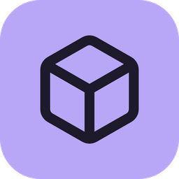
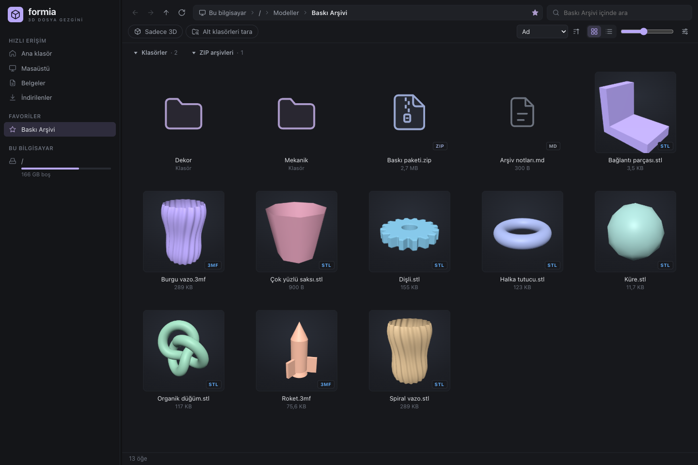
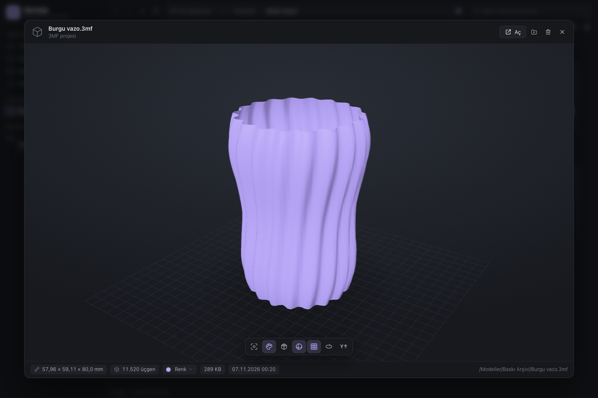
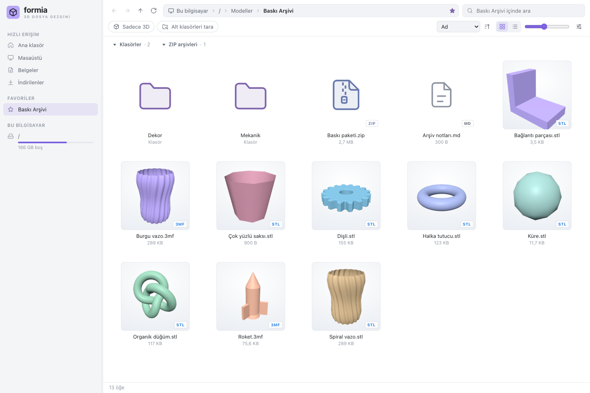
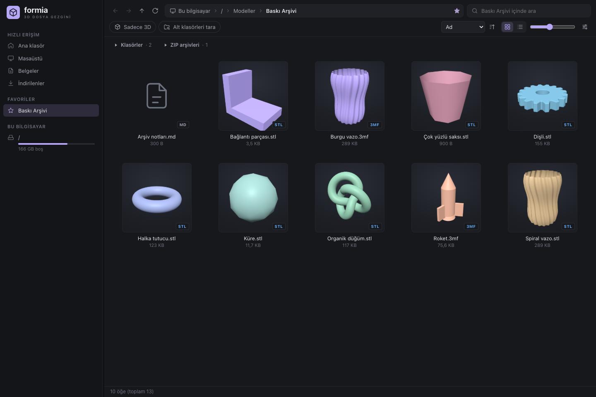

[English](README.md) | **Türkçe**

<div align="center">



# Formia

### 3D baskı arşivin, bir bakışta.

Klasörler ve ZIP’ler arasında kaybolma. Modellerini **küçük resimleriyle bul**,<br/>**Space** ile üç boyutlu incele, hazır olduğunda slicer’ına sürükle.

[](https://github.com/sessizz/formia/releases/latest) [](https://github.com/sessizz/formia/actions/workflows/windows-release.yml) [](LICENSE)  

[**İndir**](https://github.com/sessizz/formia/releases/latest) &nbsp;·&nbsp; [**Ekran görüntüleri**](#ekran-görüntüleri) &nbsp;·&nbsp; [**Kaynak koddan derle**](#kaynak-koddan-derleme) &nbsp;·&nbsp; [**Yol haritası**](ROADMAP.md) &nbsp;·&nbsp; [**Hata bildir**](https://github.com/sessizz/formia/issues)

<br/>



</div>

---

## Neden Formia?

Bir diskte STL’ler, başka bir klasörde 3MF projeleri, indirilenlerde ZIP paketleri… Formia, alıştığın dosya gezgini düzenini 3D baskı arşivine taşır. Modelleri tek tek slicer’da açmadan görebilir, ZIP’lerin içine girebilir ve bir klasörün altındaki bütün modelleri birlikte tarayabilirsin.

**Yerel bir masaüstü uygulaması.** Arşivini içe aktarmak veya dosyalarını başka yere taşımak zorunda değilsin. Tauri 2 ve Rust dosya işlemlerini üstlenir; three.js etkileşimli önizlemeyi çizer.

## İndir ve başla

| Platform | Paket | Kullanım |
| --- | --- | --- |
| **macOS · Apple Silicon** | [DMG indir](https://github.com/sessizz/formia/releases/latest/download/Formia_1.0.0_aarch64.dmg) | Aç, **Formia**’yı **Applications** klasörüne sürükle. |
| **Windows · x64** | [Kurulum EXE’si](https://github.com/sessizz/formia/releases/latest/download/Formia_1.0.0_x64-setup.exe) | Kurulum sihirbazını çalıştır. |
| **Windows · x64 · Portable** | [Tek EXE indir](https://github.com/sessizz/formia/releases/latest/download/Formia_1.0.0_x64-portable.exe) | İstediğin klasöre kaydet ve doğrudan çalıştır. |

Paketler şu an **kod imzalı değildir**; macOS Gatekeeper ve Windows SmartScreen ilk açılışta ek onay isteyebilir. Windows’ta **Microsoft Edge WebView2 Runtime** gerekir; portable paket bunu içermez. macOS paketi yalnızca Apple Silicon (`arm64`) içindir.

İndirdikten sonra:

1. Kenar çubuğundan bir klasör seç veya adres çubuğuna yolunu yapıştır.
2. Model seçip **Space**’e bas; fareyle döndür, kaydır ve yakınlaştır.
3. Dosyayı Bambu Studio, OrcaSlicer, PrusaSlicer veya kullandığın slicer’a sürükle.

[Tüm sürümler ve SHA-256 dosyaları →](https://github.com/sessizz/formia/releases)

## Özellikler

| | |
| --- | --- |
| **🧊 Space ile 3D önizleme**<br/>Ölçüler, üçgen sayısı, tel kafes, yumuşak gölgeleme, zemin ızgarası ve otomatik döndürme. | **🎨 Filament renkleri**<br/>Bambu Studio, OrcaSlicer ve PrusaSlicer 3MF renkleri. Önizlemede hazır PLA renklerini dene. |
| **🗃️ ZIP’lerin içinde gezin**<br/>Arşivi açmadan içindeki modelleri küçük resimleriyle gör ve önizle. | **📑 Çoklu plaka desteği**<br/>3MF projelerinde plakaları küçük resimleriyle seç ve ayrı ayrı incele. |
| **🧵 Bitmiş baskı görünümü**<br/>G-code’u çizgi genişliği ve katman yüksekliğiyle şeritler halinde gör. Dilimlenmiş `.gcode.3mf` de desteklenir. | **🔎 Arşivinde bul**<br/>Anlık arama, Türkçe karakter duyarsız eşleştirme, “Sadece 3D” filtresi ve alt klasör taraması. |
| **💜 Sakin bir çalışma alanı**<br/>Lavanta klasörler, fermuarlı ZIP simgeleri; her ikisini de bağımsız başlıklardan daraltıp aç. | **⚡ Büyük klasörlere hazır**<br/>Sanallaştırılmış ızgara/liste, çok iş parçacıklı küçük resim üretimi ve disk önbelleği. |

- **Favoriler ve sürücüler:** hızlı erişim, sürükleyerek sıralanan favoriler, USB/ağ sürücüleri ve doluluk çubukları.
- **Dosya işlemleri:** çoklu seçim, yerinde yeniden adlandırma, onayla Geri Dönüşüm Kutusu’na taşıma ve slicer’a sürükleme.
- **Koyu, açık ve sistem teması.** Renk menüsündeki değişiklikler yalnızca önizlemeyi etkiler; model dosyasına yazılmaz.
- **Gömülü önizlemeler:** 3MF plaka görselleri ve G-code küçük resimleri okunur. 3MF’te gömülü görsel kullanımı ayarlardan kapatılabilir.

## Ekran görüntüleri

<table>
  <tr>
    <td width="50%"><br/><sub><b>Bir tuşla modele yaklaş.</b> Space ile döndürülebilir 3D görünüm, ölçüler ve filament rengi.</sub></td>
    <td width="50%"><br/><sub><b>Açık tema.</b> Aynı lavanta dilinin aydınlık çalışma alanındaki görünümü.</sub></td>
  </tr>
  <tr>
    <td colspan="2"><br/><sub><b>Modellere yer aç.</b> Klasörleri ve ZIP’leri bağımsız daralt; dosyalar yukarı taşınır.</sub></td>
  </tr>
</table>

<sub>Görüntüler mevcut Formia arayüzünden, örnek veriler ve bu tanıtım için oluşturulan geometrik modellerle alınmıştır. Kişisel arşiv veya dosya bilgisi içermez.</sub>

## Desteklenen biçimler

| Tür | Uzantılar | Önizleme |
| --- | --- | --- |
| Baskı modelleri | `stl` `3mf` `obj` `ply` `off` | Rust ayrıştırıcı + three.js |
| Sahneler | `glb` `gltf` | Malzeme ve dokularla three.js |
| Diğer 3D biçimler | `fbx` `dae` `3ds` `amf` `wrl` `vrml` | three.js |
| CAD | `step` `stp` `iges` `igs` `brep` | OpenCascade / WebAssembly |
| Dilimlenmiş baskı | `gcode` `gco` `g` · `.gcode.3mf` | Bitmiş baskı şeritleri; büyük dosyalarda ince takım yolu çizgileri |
| Görsel ve belgeler | `png` `jpg` `webp` `gif` `bmp` `tga` · `pdf` `txt` `md` `scad` … | Görsel, PDF veya metin |
| Video | `mp4` `webm` | Video oynatımı |
| Arşiv | `zip` | Klasör gibi gezinme, model küçük resimleri ve önizleme |

3MF önizlemesinde filament atamaları, boyanmış yüzeyler ve standart `basematerials` / `colorgroup` renkleri okunur. `.gcode.3mf` içinde `Metadata/plate_N.gcode` varsa dilimlenmiş baskı gösterilir; yoksa dosya normal 3D model olarak açılır.

## Klavye kısayolları

| Tuş | İşlev |
| --- | --- |
| **Space** | Önizlemeyi aç / kapat |
| **← → ↑ ↓** | Seçimi taşı; önizlemede önceki/sonraki modele geç |
| **Enter** / çift tık | Klasörü aç veya dosyayı varsayılan uygulamada aç |
| **Cmd+↑ / Cmd+↓** (Mac) | Üst klasöre git / seçili öğeyi aç |
| **Alt+↑ / Alt+↓** (Windows) | Üst klasöre git / seçili öğeyi aç |
| **Backspace** | Üst klasöre git |
| **Alt+← / Alt+→** | Geri / ileri |
| **Ctrl+L** / **F4** | Adres çubuğunu düzenle |
| **Ctrl+F** / **Ctrl+Shift+F** | Ara / alt klasörleri tara |
| **Ctrl+D** | Bulunduğun klasörü favorilere ekle / çıkar |
| **Ctrl+1 / Ctrl+2** | Izgara / liste görünümü |
| **Ctrl+tekerlek** / **Ctrl + / −** | Küçük resim boyutu |
| **F2** | Yeniden adlandır |
| **Delete** / Mac’te **Cmd+Backspace** | Onayla Geri Dönüşüm Kutusu’na taşı |
| **F5** | Yenile |
| **R · C · W · S · G · A · U** | Önizlemede sıfırla, renkler, tel kafes, yumuşak gölgeleme, ızgara, döndürme ve yukarı ekseni |

Ctrl ile başlayan kısayolların çoğu macOS’ta **Cmd** ile de çalışır. Harf yazarak dosya adına göre seçim yapabilirsin.

## Kaynak koddan derleme

Gerekenler: **Rust stable**, **Node.js** ve platformun derleme araçları. Node.js yalnızca Tauri CLI’yi `npx` ile çalıştırmak için kullanılır.

```sh
git clone https://github.com/sessizz/formia.git
cd formia
```

### macOS · Apple Silicon

Xcode Command Line Tools kurulu olmalı (`xcode-select --install`). Ardından:

```sh
source ~/.cargo/env
./build-mac.sh
```

Çıktılar varsayılan olarak:

```text
~/.cache/model-gezgini-target/release/bundle/macos/Formia.app
~/.cache/model-gezgini-target/release/bundle/dmg/Formia_1.0.0_aarch64.dmg
```

`CARGO_TARGET_DIR` ile çıktı dizinini değiştirebilirsin. Intel/universal paket şu an destek kapsamı dışındadır.

### Windows · x64

Rust’ın **MSVC** araç zinciri, Visual Studio Build Tools’un **Desktop development with C++** bileşenleri ve WebView2 Runtime gerekir. PowerShell’de:

```powershell
# Geliştirme modunda aç
.\dev.ps1

# NSIS kurulum dosyası + taşınabilir formia.exe üret
.\build.ps1
```

Betik, üretilen kurulum ve portable EXE’nin tam yollarını yazar. Geliştirme modunda arayüz değişikliklerini **Ctrl+R** ile yeniden yükleyebilirsin.

### Testler

```sh
cd src-tauri
cargo test
```

<details>
<summary><b>Bağımlılıklar, derleme önbelleği ve release akışı</b></summary>

- Proje npm uygulaması değildir; **`npm install` veya `node_modules` gerekmez**. three.js ve OpenCascade bağımlılıkları `ui/vendor/` altında bulunur.
- Tauri CLI, `npx --yes @tauri-apps/cli@2` ile npm önbelleğinden indirilip çalıştırılır.
- Kaynak kod makineler arasında Git ile paylaşılır; derleme çıktıları ve bağımlılıklar her makinede yerel üretilir.
- Windows’ta yerel Rust çıktı dizini, Git’e eklenmeyen `src-tauri/.cargo/config.toml` dosyasındaki `[build] target-dir` ile ayarlanabilir.
- [Windows release akışı](.github/workflows/windows-release.yml) elle başlatılır. Var olan **taslak release** ve onun kaynak commit SHA’sı verilince Rust testlerini çalıştırır, NSIS kurulumunu ve tek portable EXE’yi üretip SHA-256 dosyalarıyla taslağa yükler. Release’i kendiliğinden yayımlamaz.
- Otomatik uygulama güncellemesi ve kod imzalama henüz yoktur; planlar [yol haritasında](ROADMAP.md).

</details>

## Mimari

```text
src-tauri/src/          Rust arka uç
  lib.rs               Tauri komutları, thumb:// raw:// mesh:// protokolleri
  fs_ops.rs · vfs.rs    Dosya sistemi, sürücüler ve ZIP sanal yolları
  scan.rs              Alt klasör ve arşiv taraması
  thumbs.rs · raster.rs  Küçük resim kuyruğu, disk önbelleği, yazılım çizimi
  mesh/                Model ayrıştırıcıları ve G-code şerit geometrisi
  migrate.rs           Eski Model Gezgini verilerinin geçişi
ui/                    Düz HTML / CSS / JavaScript
  js/main.js           Gezinme, filtreler, kısayollar
  js/fileview.js       Sanallaştırılmış ızgara / liste
  js/preview.js        Space önizlemesi ve plaka / renk kontrolleri
  js/viewer3d.js        three.js görüntüleyici
  js/loaders.js        Rust, three.js ve OpenCascade model yükleyicileri
  vendor/              Gömülü görüntüleme bağımlılıkları
```

### Kullanıcı verileri

Uygulama kimliği `com.sessizz.formia`’dır. Windows’ta ayarlar ve favoriler `%APPDATA%\com.sessizz.formia\settings.json`, küçük resimler `%LOCALAPPDATA%\com.sessizz.formia\thumbs` altında tutulur. macOS’ta Tauri’nin uygulama yapılandırma ve önbellek dizinleri kullanılır.

Eski **Model Gezgini** (`com.modelgezgini.app`) ayarları, favorileri ve küçük resimleri ilk açılışta taşınır. Küçük resim önbelleğini **Ayarlar → Temizle** ile silebilirsin.

## Bilinen sınırlamalar

- Boyanmış tek bir üçgenin içindeki çoklu renkler, en büyük alanı kaplayan renkle gösterilir; çok ince boyama sınırları kabalaşabilir.
- Büyük STEP dosyalarını dönüştürmek birkaç saniye sürebilir.
- Çok büyük G-code dosyalarında şeritler yerine ince çizgilere dönülür; önizleme sınırı 80 MB’tır.
- ZIP içindeki dosyalar silinemez veya yeniden adlandırılamaz.
- Uygulama içinde kopyalama/taşıma yoktur; **Klasörde göster** ile işletim sisteminin dosya yöneticisini açabilirsin.

## Katkıda bulun

Hata raporları ve pull request’ler memnuniyetle karşılanır. Bir hata bildirirken işletim sistemini, dosya biçimini ve tekrar üretme adımlarını ekle; paylaşabildiğin küçük bir örnek dosya tanıyı kolaylaştırır.

Yeni özellikler için önce [yol haritasına](ROADMAP.md), kodla çalışmadan önce [ajan çalışma rehberine](AGENTS.md) göz at.

## Lisans

[MIT](LICENSE). Gömülü bağımlılıkların lisansları [THIRD_PARTY_NOTICES.md](THIRD_PARTY_NOTICES.md) içinde listelenir.
